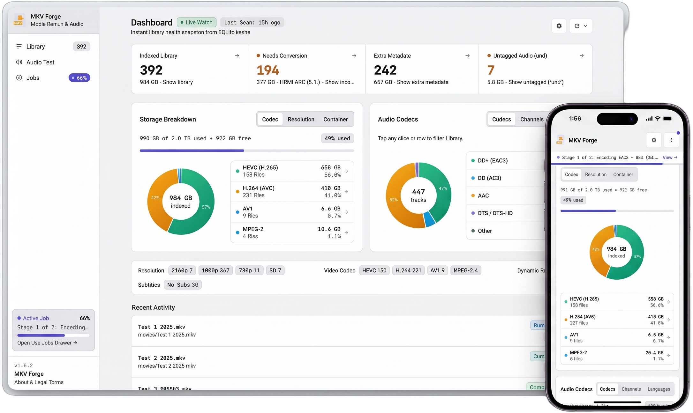
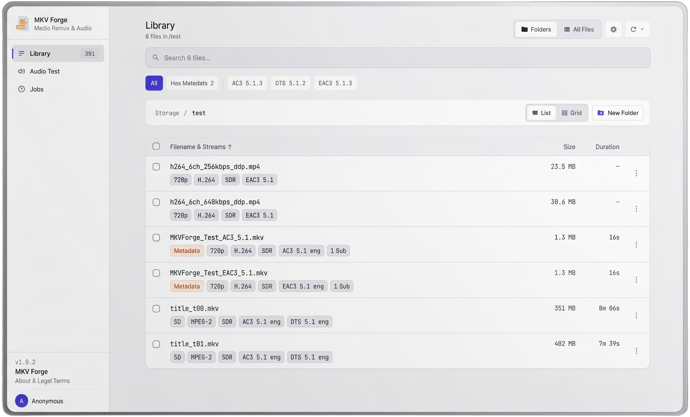
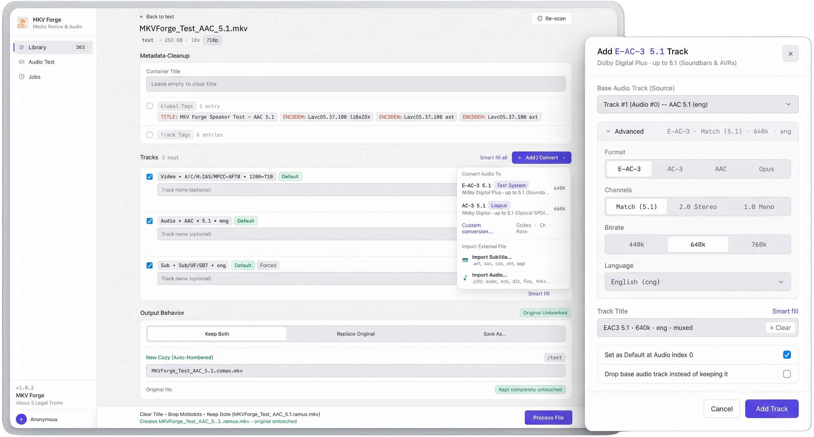
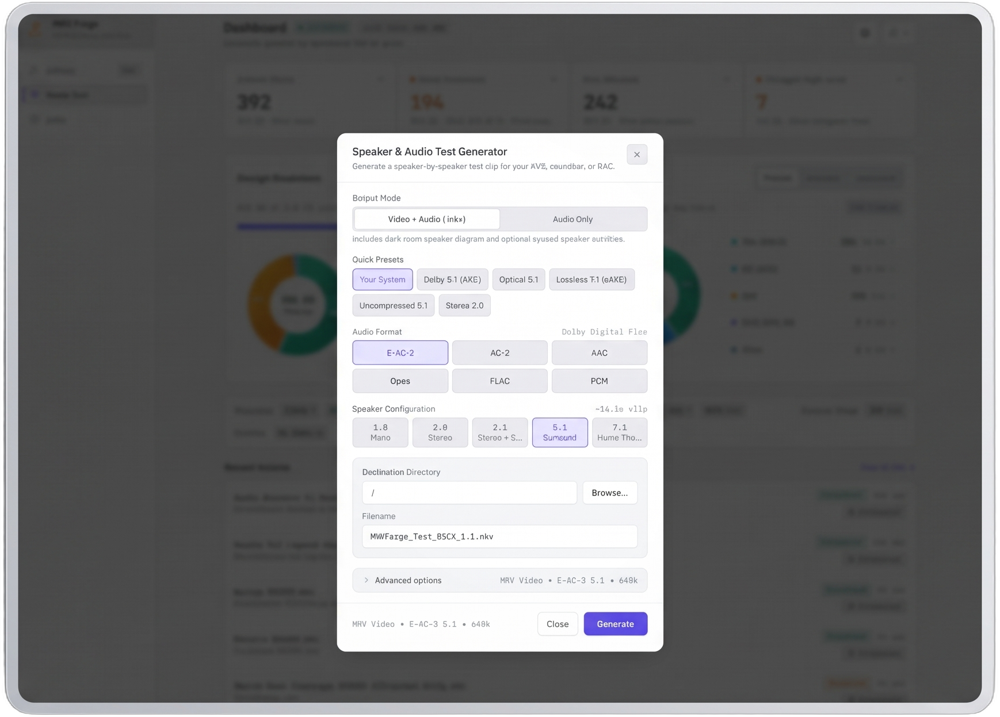
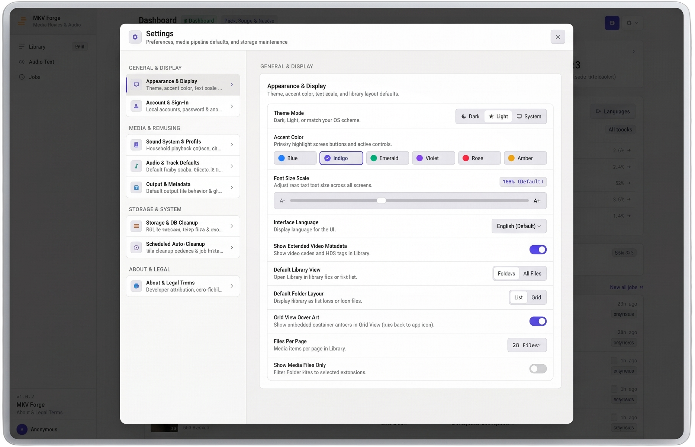

<div align="center">
  

  # MKV Forge

  **The friendly, self-hosted media workshop for your movie & TV library.**  
  Fix surround sound, clean up messy movie titles, and manage subtitles right from your phone or computer—with zero video quality loss.

  <p>
    <a href="https://www.buymeacoffee.com/manojbiswas" target="_blank">
      
    </a>
  </p>
</div>

<p align="center">
  
</p>

---

## Why MKV Forge?

If you watch movies or TV shows on **Plex, Jellyfin, Emby, Infuse, or a TV/Soundbar**, you have probably run into these everyday headaches:

* **"Why is my surround sound playing in stereo (or silent)?"** — Many downloaded or ripped movies use **AAC 5.1**, **DTS**, or **TrueHD** audio that most TVs and soundbars cannot play natively. They need **Dolby Digital Plus (`EAC3`)** or **Dolby Digital (`AC3`)**.
* **"Why does my TV show an ugly title like `Movie.2025.1080p.WEB-DL.x265-GROUP`?"** — Media files often hide messy release tags inside their internal metadata that override your clean filenames.
* **"Why does Plex or Jellyfin pick the wrong audio language?"** — Audio and subtitle tracks are often left untagged as **`und` (Undefined)** or set to the wrong default track.
* **"I just want to add a subtitle file or drop 10 languages I don't speak"** — Without opening a complicated desktop program, re-encoding the video, or typing command-line flags.

**MKV Forge** gives you a clean, modern web app that runs on your home server or NAS and works just as smoothly on your **phone** as it does on your **desktop**. Because it **never re-encodes your video**, there is **zero video quality loss** and movies finish processing in seconds.

---

## Visual Tour & Features

### 1. Instant Library Health Dashboard (Web & Mobile)
See your entire collection at a glance *(shown above)*—how much storage is used by video format (`HEVC`, `H.264`, `AV1`) or resolution (`4K`, `1080p`), what audio formats, channels, and languages your library has, and which files need attention. Tap any card, chart slice, or tag (`Needs Conversion`, `Extra Metadata`, `Untagged Audio (und)`, `No Subs`) to jump straight to those files.

---

### 2. Built-In Library Explorer (List View & Cover-Art Grid View)
Browse your folders directly in the browser without copying files back and forth:
* **Detailed List View:** Scan resolution, video format, HDR/Dolby Vision status, audio tracks, and subtitle counts at a glance, or filter by sound format with a single tap.
* **Cover-Art Grid View:** Switch to **Grid View** to browse your folders as visual tiles—automatically displaying embedded container/MKV cover artwork (poster or album art) when present.
* **Full File Manager:** Create folders and **Rename, Move, Duplicate, or Delete** files right from your browser or phone.

<p align="center">
  
</p>

---

### 3. All-in-One File Editor & One-Click Dolby Audio Converter
Open any `.mkv` or `.mp4` file to inspect and fix everything in one place:
* **Recommended Audio for Your Sound System:** Click **`+ Add / Convert`** to create a compatible **Dolby Digital Plus (`E-AC-3`)**, **Dolby Digital (`AC-3`)**, **AAC**, **Opus**, or **FLAC** track tailored to your TV, soundbar, or home theater receiver. Keep both audio tracks or replace the original automatically.
* **One-Tap `Smart fill` & Metadata Cleanup:** Opening a file automatically prepares a clean slate by stripping junk container titles and extra tags while keeping your chapters intact. Tap **`Smart fill all`** to give every track a clean, readable label (like `EAC3 5.1 • 640k • eng • muxed`).
* **Keep, Reorder & Import Tracks:** Toggle tracks on or off, reorder them, fix language tags, mark **Default** / **Forced** subtitles, or upload external **Subtitles** (`.srt`, `.ass`, `.vtt`, `.sup`) and **Audio** files straight from your device.
* **Safe Output Choices:** Choose **Keep Both** (creates a `.remux.mkv` copy while leaving your original file untouched), **Replace Original** (safely swaps only after the new file finishes cleanly), or **Save As…**.

<p align="center">
  
</p>

---

### 4. Built-In Speaker & Audio System Test Generator
Not sure if your TV, soundbar, or receiver actually supports **Dolby Digital Plus 5.1**, **Lossless 7.1**, or **AAC 5.1**? Generate a short, speaker-by-speaker test clip directly into your library folder and play it on your TV to verify every speaker channel before converting your movies.

<p align="center">
  
</p>

---

### 5. Personalized Appearance, Sound Profile & Zero-Maintenance Storage
Tailor MKV Forge to your household in **Settings**:
* **Dark & Light Modes + 6 Accent Colors:** Switch between Dark, Light, or System theme, pick from 6 accent colors (`Blue`, `Indigo`, `Emerald`, `Violet`, `Rose`, `Amber`), adjust interface **Font Size Scale** (`85%`–`125%`), and toggle **Grid View Cover Art**.
* **Household Sound System Profile:** Pick your setup once (TV Speakers, Dolby ARC Soundbar, Optical Receiver, or eARC 7.1 AVR) so MKV Forge knows which files in your library need audio conversion.
* **Hands-Free Cleanup & Optional Sign-In:** Run in simple passwordless homelab mode or enable **Local Sign-In** with user accounts and API keys, plus automatic background database and temp-file cleanup.

<p align="center">
  
</p>

---

## Quick Start with Docker

No coding or manual building required—**MKV Forge** runs as a single, 100% offline Docker container (`linux/amd64` and `linux/arm64` for PCs, NAS devices, and Raspberry Pi / Apple Silicon).

### Option 1: Docker Compose (Recommended)

1. Create a `docker-compose.yml` file and point `/path/to/your/media` to your movie/TV folder:

```yaml
services:
  mkv-forge:
    image: ghcr.io/manswis/mkv-forge:latest
    container_name: mkv-forge
    restart: unless-stopped
    ports:
      - "7788:7788"
    environment:
      PUID: "1000"
      PGID: "1000"
      UMASK: "022"
      TZ: "America/Toronto"
    volumes:
      - ./data:/app/data:rw
      - /path/to/your/media:/storage:rw
```

2. Start MKV Forge:

```bash
docker compose up -d
```

3. Open **`http://localhost:7788`** (or `http://<your-server-ip>:7788`) in your browser and follow the quick 3-step welcome setup.

---

### Option 2: Docker CLI (`docker run`)

```bash
docker run -d \
  --name mkv-forge \
  --restart unless-stopped \
  -p 7788:7788 \
  -e PUID=1000 \
  -e PGID=1000 \
  -e UMASK=022 \
  -e TZ=America/Toronto \
  -v "$(pwd)/data:/app/data:rw" \
  -v "/path/to/your/media:/storage:rw" \
  ghcr.io/manswis/mkv-forge:latest
```

---

### Image Release Channels

| Channel Tag | Image Reference | When It Updates | Who Should Use It |
| :--- | :--- | :--- | :--- |
| **`:latest` (Stable)** | `ghcr.io/manswis/mkv-forge:latest`<br/>*(or `manswis/mkv-forge:latest`)* | **Only on tagged releases** (`v*.*.*`, e.g. `v1.0.2`) | Recommended for daily home server / NAS users who want tested, stable releases. |
| **`:nightly` / `:beta`** | `ghcr.io/manswis/mkv-forge:nightly`<br/>`ghcr.io/manswis/mkv-forge:beta` | **Every commit pushed to `main`** | Users who want the newest features and fixes immediately as they land on `main`. |
| **`:<version>` (Pinned)** | `ghcr.io/manswis/mkv-forge:1.0.2` | Immutable version tag | Users who prefer pinning an exact release version. |

<details>
<summary><strong>Build from Source (Local Development)</strong></summary>

```bash
git clone https://github.com/manswis/Mkv-Forge.git
cd Mkv-Forge
docker build -t mkv-forge:local .
```

</details>

---

## Configuration (Environment Variables)

Everything works out of the box with default settings. Expand the guide below only if you want to customize file permissions, network drive watching (NFS/SMB), or external USB drive sleep behavior.

<details>
<summary><strong>View Environment Variables &amp; Network / USB Drive Watch Modes</strong></summary>

<br/>

| Variable | Default | Required? | What It Does |
| :--- | :--- | :---: | :--- |
| `PUID` / `PGID` | `1000` / `1000` | Optional | Linux user & group ID so created `.mkv` files match your NAS/host permissions. |
| `UMASK` | `022` | Optional | File creation permission mask inside `/storage`. |
| `TZ` | `UTC` | Recommended | Your local timezone for logs, timestamps, and scheduled maintenance. |
| `MKVFORGE_WATCH_MODE` | `watch` | Optional | How MKV Forge detects new or modified files (`watch`, `poll`, or `off`). See table below. |
| `MKVFORGE_WATCH_DEBOUNCE_SEC` | `8` | Optional | Quiet window (seconds, `0.05`–`300`) to wait after a file finishes copying before scanning it. |
| `MKVFORGE_SCAN_INTERVAL_MIN` | `0` | Optional | Periodic background scan interval in minutes (`0` = disabled, max `10080` / 7 days). |
| `MKVFORGE_STORAGE_DIR` | `/storage` | Optional | Container path where your media library is mounted. Only change if you mount your media to a custom path other than `/storage`. |
| `MKVFORGE_DATA_DIR` | `/app/data` | Optional | Container path for the SQLite cache database (`mkvforge.db`), thumbnails, and temporary uploads. |
| `MKVFORGE_LOG_LEVEL` | `INFO` | Optional | Application log level (`DEBUG`, `INFO`, `WARNING`, `ERROR`, `CRITICAL`). |

### Choosing the Right `MKVFORGE_WATCH_MODE`

| Mode | Default? | How It Works | Best For |
| :--- | :---: | :--- | :--- |
| **`watch`** | **Yes** | Listens to instant OS file events (`inotify` on Linux) with zero idle disk activity. | Local SSDs/HDDs, direct USB drives on the host, or local ZFS/RAID/Unraid arrays. |
| **`poll`** | No | Checks `/storage` every `2` seconds to detect changes over network mounts. | Remote network shares (**NFS**, **SMB/CIFS**, or **rclone**) mounted from a separate NAS. |
| **`off`** | No | Turns off background file watching completely; scans only happen when you click **Scan** or browse a folder. | External USB spinning hard drives that you want to spin down and sleep when idle. |

</details>

---

## Dashboard Integrations & API Keys

MKV Forge includes a built-in JSON API for homelab dashboards (like [Homepage](https://gethomepage.dev/), Dashy, or Heimdall).

<details>
<summary><strong>View API Key Setup &amp; Homepage (gethomepage.dev) Widget Snippet</strong></summary>

<br/>

### Generating an API Key
If **Local Sign-In** is enabled:
1. Open **Settings (⚙️) → Account & Sign-In**.
2. Under **API Keys & Integrations**, enter a name (e.g., `Homepage`) and click **+ Generate New Key**.
3. Copy the key (`mkv_...`) and pass it via `x-api-key: mkv_your_key_here` or `Authorization: Bearer mkv_your_key_here`. *(In passwordless Anonymous mode, no API key is required.)*

### Homepage (`services.yaml`) Example

```yaml
    - MKV Forge:
        icon: mkvtoolnix.png
        href: http://mkv-forge.lab
        description: Media Workshop & Dolby Converter
        ping: http://mkv-forge:7788/api/health
        widget:
          type: customapi
          url: http://mkv-forge:7788/api/dashboard
          headers:
            x-api-key: "mkv_your_generated_api_key_here"
          showStats: true
          mappings:
            - field: stats.total_files
              label: Movies & Shows
              format: number
            - field: stats.needs_conversion
              label: Needs Conversion
              format: number
            - field: stats.has_metadata
              label: Extra Metadata
              format: number
            - field: stats.untagged_audio
              label: Untagged Audio
              format: number
```

</details>

---

## Legal & Liability Disclaimer

**MKV Forge** is open-source software distributed under the **MIT License**.

By downloading, installing, running, containerizing, or interacting with MKV Forge, you expressly acknowledge and agree to the following terms:

1. **"AS IS" & Express Warranty Disclaimer:** The software is provided "AS IS" and "AS AVAILABLE", without warranties of any kind (express, implied, statutory, or otherwise), including but not limited to the implied warranties of merchantability, fitness for a particular purpose, non-infringement, quiet enjoyment, or uninterrupted operation.
2. **Developer Zero-Liability & Absolute Hold Harmless:** In no event shall the author (**Manoj Biswas**) or any contributors be liable under any legal theory (contract, tort, strict liability, negligence, breach of statutory duty, or otherwise) for any direct, indirect, incidental, punitive, special, consequential, or exemplary damages—including, without limitation, corruption, truncation, overwrite, or permanent loss of media files, hardware failure, disk corruption, filesystem errors, or media server downtime.
3. **Deemed Consent by Continued Use:** Your continued use, deployment, or hosting of this software constitutes full and binding legal acceptance of these terms. If you do not accept these terms, you must immediately cease all use and delete all copies of the software and images.
4. **No Litigation & Covenant Not to Sue:** You irrevocably covenant that you will not initiate, maintain, or participate in any lawsuit, arbitration, claim, or class-action litigation against the author in any jurisdiction worldwide.
5. **Sole User Responsibility for Backups:** Media processing operations (including "Replace Original" and in-place deletions) modify files on disk. The user bears sole responsibility for maintaining independent, verified backups of all original media prior to remuxing or converting audio.
6. **100% Offline & Private:** MKV Forge contains zero telemetry, zero analytics, zero external tracking, and zero remote cloud connectivity. All processing executes locally on your private machine or server.
7. **Trademarks, Non-Affiliation & Codec Patent Notice:** "Dolby", "Dolby Digital", "Dolby Digital Plus", "Dolby TrueHD", "Dolby Atmos", and "Dolby Vision" are trademarks or registered trademarks of Dolby Laboratories Licensing Corporation. "DTS" and "DTS-HD" are registered trademarks of DTS, Inc. (Xperi Inc.). "HDMI" is a registered trademark of HDMI Licensing Administrator, Inc. "Plex", "Jellyfin", "Emby", and "Infuse" are trademarks of their respective owners. All third-party trademarks, service marks, trade names, and format names referenced in MKV Forge or its documentation are the property of their respective owners and are used strictly for nominative, descriptive, and technical interoperability identification. **MKV Forge is an independent open-source project and is not affiliated with, endorsed by, certified by, sponsored by, or licensed by Dolby Laboratories, DTS, Inc., or any other trademark holder.** Audio transcoding and container muxing are performed by external open-source packages (`FFmpeg` and `MKVToolNix`) in the user's local environment; this software does not grant any third-party patent or trademark licenses.

---

## Support the Project

If **MKV Forge** saves you time managing your media library, consider supporting its development:

<a href="https://www.buymeacoffee.com/manojbiswas" target="_blank">
  
</a>
