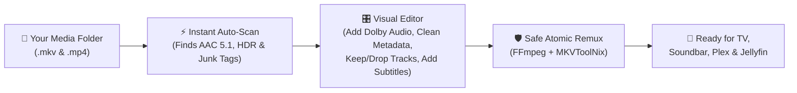

<div align="center">
  

  # MKV Forge

  **The friendly, self-hosted media workshop for your movie & TV library.**  
  Fix incompatible audio for your TV or soundbar, clean up messy release-group metadata, add external subtitles, and remux `.mkv` / `.mp4` files in seconds—without touching the command line.

  <p>
    <a href="https://www.buymeacoffee.com/manojbiswas" target="_blank">
      
    </a>
  </p>
</div>

---

## Why MKV Forge?

If you collect movies or shows for **Plex, Jellyfin, Emby, Infuse, or a USB drive plugged into your TV**, you have probably run into these everyday frustrations:

* **"No surround sound on my TV/Soundbar"** — Many downloads only include **AAC 5.1** audio, which most TVs and receivers downmix to stereo because they expect **Dolby Digital (AC3)** or **Dolby Digital Plus (EAC3)**.
* **"Messy titles & release tags"** — Media players often display ugly embedded titles like `Movie.2026.1080p.WEB-DL.x265-GROUP` instead of the actual filename, or show cluttered track names.
* **"Wrong default audio or subtitle track"** — A movie starts playing in the wrong language, or you want to drop 15 unused audio/subtitle languages to save gigabytes of space.
* **"I have an `.mp4` or external `.srt` file"** — You just want to drop an `.srt`/`.ass` subtitle or extra audio file into your movie and save a clean `.mkv` without re-encoding the video.

**MKV Forge** solves all of this through a clean web interface that works just as smoothly on your **phone or tablet** as it does on your **desktop**. Your video stream is **never re-encoded**, so there is **zero video quality loss** and jobs finish at disk speed.

---

## How It Works



---

## Key Features

### 1. One-Click Dolby Audio Conversion (`EAC3` / `AC3` / `AAC`)
* Convert incompatible **AAC 5.1**, **DTS**, or **TrueHD** audio into universally supported **Dolby Digital Plus (`EAC3`)** or **Dolby Digital (`AC3`)** at `640k`, `448k`, or `384k`.
* Keep the original audio track alongside the new Dolby track, or drop the original automatically.
* Automatically preserves audio sync delays and sets your new track as the default (`Audio Index 0`).

### 2. Automatic Metadata & Track Cleanup
* **Remove All Metadata by Default:** Opening a file automatically prepares a clean slate—clearing embedded container titles, track titles, global tags, and unchecking attachments while keeping your chapters intact.
* **One-Click `Sanitize metadata` & `Sanitize all`:** Replace messy track titles with clean, readable labels like `Video • HEVC/H.265/MPEG-H • 1920x1080` or `Audio • AAC • 5.1 • hin` (and `EAC3 5.1 • 640k • hin • muxed` for newly created audio).

### 3. Visual Track & External File Manager
* Toggle video, audio, and subtitle tracks on/off, reorder tracks up/down, change language tags, and toggle **Default** / **Forced** flags.
* Import external **Subtitles** (`.srt`, `.ass`, `.ssa`, `.vtt`, `.sup`) or **Audio** (`.ac3`, `.eac3`, `.aac`, `.dts`, `.flac`, `.mka`, `.mp3`, `.opus`, `.m4a`) from your server storage or directly from your phone/computer.

### 4. Visual Dashboard & Explorer Library
* **Interactive Dashboard:** See your storage breakdown (`MKV`, `MP4`, `Other / Non-Indexed`), audio codec distribution (`DD+`, `DD`, `AAC`, `DTS`, `TrueHD`), and video resolution / HDR pills (`2160p`, `1080p`, `DV HDR`, `HDR10`, `HLG`, `SDR`) at a glance.
* **Actionable Filters:** Jump straight to files that have **AAC 5.1 Only**, **Extra Metadata**, or a specific **Audio Codec** with one tap.
* **Built-In File Explorer:** Browse folders in **List** or **Grid** view, inspect full media details, create folders, and **Rename, Duplicate, Move, or Delete** files right from the browser.

### 5. Safe by Design
* **3 Output Modes:** **Keep Both** (`Movie.remux.mkv`), **Replace Original** (atomic swap only after the new file finishes cleanly), or **Save As…** (with an optional *Delete original file after Save As* toggle).
* **Live File Watcher:** Automatically detects newly added or uploaded files on your drive without manual rescans.
* **Optional Local Accounts:** Run in frictionless **Anonymous Homelab Mode** or enable **Local Sign-In** with per-user theme, accent color, and editor preferences.

---

## Quick Start with Docker

### Option 1: Docker Compose (Recommended)

Create a `docker-compose.yml` file:

```yaml
services:
  mkv-forge:
    image: mkv-forge:latest
    build:
      context: .
      dockerfile: Dockerfile
    container_name: mkv-forge
    restart: unless-stopped
    ports:
      - "7788:7788"
    environment:
      PUID: "1000"
      PGID: "1000"
      UMASK: "022"
      TZ: "America/Toronto"
      MKVFORGE_STORAGE_DIR: "/storage"
      MKVFORGE_DATA_DIR: "/app/data"
      MKVFORGE_WATCH_MODE: "watch"
    volumes:
      - ./data:/app/data:rw
      - /path/to/your/media:/storage:rw
```

Start the container:

```bash
git clone https://github.com/manojbiswas/Mkv-Forge.git
cd Mkv-Forge
# Edit docker-compose.yml to point /path/to/your/media to your movies/shows folder
docker compose up -d --build
```

Then open **`http://localhost:7788`** (or `http://<your-server-ip>:7788`) in your browser.

---

### Option 2: Docker CLI (`docker run`)

```bash
docker build -t mkv-forge:latest .

docker run -d \
  --name mkv-forge \
  --restart unless-stopped \
  -p 7788:7788 \
  -e PUID=1000 \
  -e PGID=1000 \
  -e UMASK=022 \
  -e TZ=America/Toronto \
  -v "$(pwd)/data:/app/data:rw" \
  -v "/path/to/your/media:/storage:rw" \
  mkv-forge:latest
```

---

## Configuration (Environment Variables)

| Variable | Default | What It Does |
| :--- | :--- | :--- |
| `PUID` / `PGID` | `1000` / `1000` | Linux user & group ID so created `.mkv` files match your NAS/host permissions. |
| `UMASK` | `022` | File creation permission mask inside `/storage`. |
| `TZ` | `UTC` | Your local timezone for logs, timestamps, and scheduled maintenance. |
| `MKVFORGE_STORAGE_DIR` | `/storage` | Container path where your media library is mounted. |
| `MKVFORGE_DATA_DIR` | `/app/data` | Container path for the SQLite cache database (`mkvforge.db`) and temp uploads. |
| `MKVFORGE_WATCH_MODE` | `watch` | `watch` for live filesystem detection, `poll` for network shares (NFS/SMB), or `off`. |
| `MKVFORGE_WATCH_DEBOUNCE_SEC` | `8` | Quiet window (seconds) to wait after a file upload finishes before probing metadata. |
| `MKVFORGE_SCAN_INTERVAL_MIN` | `0` | Optional periodic background scan interval in minutes (`0` = disabled). |

---

## Under the Hood (Technical Details)

* **100% Offline Single Container:** No cloud dependencies, no external CDNs, and no telemetry—runs completely on your local network.
* **Backend:** Python **FastAPI** + **SQLite (WAL mode)** + **Server-Sent Events (SSE)** for real-time scan progress, job logs, and live folder updates.
* **Media Engine:** **MKVToolNix** (`mkvmerge -J` for nanosecond-accurate probing & Stage 2 lossless remuxing) + **FFmpeg / ffprobe** (Stage 1 audio transcoding with automatic Dolby sample-rate and 5.1 channel-layout safety).
* **Frontend:** Lightweight **Alpine.js** + **Tailwind CSS** (compiled offline during the Docker build) with 6 accent themes, Dark/Light/System modes, and mobile touch gestures.

---

## Roadmap

- [ ] **Browser File Upload & Download** — Upload media files directly into `/storage` folders and download finished `.mkv` files straight from the web UI.
- [ ] **Batch Processing** — Apply audio conversion, track filtering, and metadata cleanup across an entire TV season or folder in one click.
- [ ] **Saved Presets & Profiles** — Save custom remux profiles (e.g., *"Keep Hindi + English, Convert AAC 5.1 → EAC3 640k, Strip All Tags"*).
- [ ] **Subtitle Tools** — Extract embedded subtitles to `.srt`/`.ass` and preview subtitle text before remuxing.
- [ ] **Media Server Webhooks** — Automatically notify **Plex**, **Jellyfin**, **Emby**, **Sonarr**, or **Radarr** to refresh a folder after a remux completes.

---

## Support the Project

If **MKV Forge** saves you time managing your media library, consider supporting its development:

<a href="https://www.buymeacoffee.com/manojbiswas" target="_blank">
  
</a>
