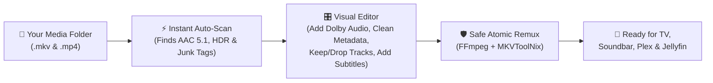

<div align="center">
  

  # MKV Forge

  **The friendly, self-hosted media workshop for your movie & TV library.**  
A lightweight, modern web alternative to MKVToolNix—with a built-in file browser and audio converter.

Browse your movie and TV folders right from your phone or computer, pick any file, and fix it in place. There’s no tedious adding, exporting, or juggling multiple tools: clean up messy titles and metadata, add or reorder subtitles, and convert incompatible surround sound (like AAC or DTS to Dolby AC3/EAC3, and vice versa) in a few taps—without ever losing video quality or touching the command line.

  <p>
    <a href="https://www.buymeacoffee.com/manojbiswas" target="_blank">
      
    </a>
  </p>
</div>

---

## Why MKV Forge?

If you collect movies or shows for **Plex, Jellyfin, Emby, Infuse, or a USB drive plugged into your TV**, you have probably run into these everyday frustrations:

* **"No surround sound on my TV/Soundbar"** — Many downloads only include **AAC 5.1** audio, which most TVs and receivers downmix to stereo because they expect **Dolby Digital (AC3)** or **Dolby Digital Plus (EAC3)**.
* **"Messy titles & release tags"** — Media players often display ugly embedded titles like `Movie.2026.1080p.WEB-DL.x265-GROUP` instead of the actual filename, or show cluttered track names.
* **"Wrong default audio or subtitle track"** — A movie starts playing in the wrong language, or you want to drop 15 unused audio/subtitle languages to save gigabytes of space.
* **"I have an `.mp4` or external `.srt` file"** — You just want to drop an `.srt`/`.ass` subtitle or extra audio file into your movie and save a clean `.mkv` without re-encoding the video.

**MKV Forge** solves all of this through a clean web interface that works just as smoothly on your **phone or tablet** as it does on your **desktop**. Your video stream is **never re-encoded**, so there is **zero video quality loss** and jobs finish at disk speed.

---

## How It Works



---

## Key Features

### 1. One-Click Dolby Audio Conversion (`EAC3` / `AC3` / `AAC`)
* Convert incompatible **AAC 5.1**, **DTS**, or **TrueHD** audio into universally supported **Dolby Digital Plus (`EAC3`)** or **Dolby Digital (`AC3`)** at `640k`, `448k`, or `384k`.
* Keep the original audio track alongside the new Dolby track, or drop the original automatically.
* Automatically preserves audio sync delays and sets your new track as the default (`Audio Index 0`).

### 2. Automatic Metadata & Track Cleanup
* **Remove All Metadata by Default:** Opening a file automatically prepares a clean slate—clearing embedded container titles, track titles, global tags, and unchecking attachments while keeping your chapters intact.
* **One-Click `Sanitize metadata` & `Sanitize all`:** Replace messy track titles with clean, readable labels like `Video • HEVC/H.265/MPEG-H • 1920x1080` or `Audio • AAC • 5.1 • hin` (and `EAC3 5.1 • 640k • hin • muxed` for newly created audio).

### 3. Visual Track & External File Manager
* Toggle video, audio, and subtitle tracks on/off, reorder tracks up/down, change language tags, and toggle **Default** / **Forced** flags.
* Import external **Subtitles** (`.srt`, `.ass`, `.ssa`, `.vtt`, `.sup`) or **Audio** (`.ac3`, `.eac3`, `.aac`, `.dts`, `.flac`, `.mka`, `.mp3`, `.opus`, `.m4a`) from your server storage or directly from your phone/computer.

### 4. Visual Dashboard & Explorer Library
* **Interactive Dashboard:** See your storage breakdown (`MKV`, `MP4`, `Other / Non-Indexed`), audio codec distribution (`DD+`, `DD`, `AAC`, `DTS`, `TrueHD`), and video resolution / HDR pills (`2160p`, `1080p`, `DV HDR`, `HDR10`, `HLG`, `SDR`) at a glance.
* **Actionable Filters:** Jump straight to files that have **AAC 5.1 Only**, **Extra Metadata**, or a specific **Audio Codec** with one tap.
* **Built-In File Explorer:** Browse folders in **List** or **Grid** view, inspect full media details, create folders, and **Rename, Duplicate, Move, or Delete** files right from the browser.

### 5. Safe by Design
* **3 Output Modes:** **Keep Both** (`Movie.remux.mkv`), **Replace Original** (atomic swap only after the new file finishes cleanly), or **Save As…** (with an optional *Delete original file after Save As* toggle).
* **Live File Watcher:** Automatically detects newly added or uploaded files on your drive without manual rescans.
* **Optional Local Accounts:** Run in frictionless **Anonymous Homelab Mode** or enable **Local Sign-In** with per-user theme, accent color, and editor preferences.

---

## Quick Start with Docker

No cloning or local building required—**MKV Forge** publishes pre-built multi-architecture images (`linux/amd64` & `linux/arm64`) directly to GitHub Container Registry and Docker Hub.

### Image Release Channels

| Channel Tag | Image Reference | When It Updates | Who Should Use It |
| :--- | :--- | :--- | :--- |
| **`:latest` (Stable)** | `ghcr.io/manswis/mkv-forge:latest`<br/>*(or `manswis/mkv-forge:latest`)* | **Only on tagged releases** (`v*.*.*`, e.g. `v1.0.0`) | Recommended for daily homelab / NAS users who want tested, stable releases. |
| **`:nightly` / `:beta`** | `ghcr.io/manswis/mkv-forge:nightly`<br/>`ghcr.io/manswis/mkv-forge:beta` | **Every commit pushed to `main`** | Users who want the newest features and fixes immediately as they land on `main`. |
| **`:<version>` (Pinned)** | `ghcr.io/manswis/mkv-forge:1.0.0` | Immutable semantic version tag | Users who prefer pinning an exact release version. |

---

### Option 1: Docker Compose (Recommended)

Create a `docker-compose.yml` file anywhere on your server or NAS:

```yaml
services:
  mkv-forge:
    # Stable release channel (use :nightly or :beta for bleeding-edge commits)
    image: ghcr.io/manswis/mkv-forge:latest
    container_name: mkv-forge
    restart: unless-stopped
    ports:
      - "7788:7788"
    environment:
      PUID: "1000"
      PGID: "1000"
      UMASK: "022"
      TZ: "America/Toronto"
      # Optional: change watch mode ("watch" = default, "poll" = NFS/SMB, "off" = manual/HDD sleep)
      # MKVFORGE_WATCH_MODE: "watch"
    volumes:
      - ./data:/app/data:rw
      - /path/to/your/media:/storage:rw
```

> **Note:** As long as your `volumes:` mount to `/app/data` and `/storage`, you do **not** need to set `MKVFORGE_DATA_DIR` or `MKVFORGE_STORAGE_DIR`—those container paths are already the built-in defaults.

Start the container:

```bash
docker compose up -d
```

Then open **`http://localhost:7788`** (or `http://<your-server-ip>:7788`) in your browser.

---

### Option 2: Docker CLI (`docker run`)

```bash
docker run -d \
  --name mkv-forge \
  --restart unless-stopped \
  -p 7788:7788 \
  -e PUID=1000 \
  -e PGID=1000 \
  -e UMASK=022 \
  -e TZ=America/Toronto \
  -v "$(pwd)/data:/app/data:rw" \
  -v "/path/to/your/media:/storage:rw" \
  ghcr.io/manswis/mkv-forge:latest
```

---

### Option 3: Build from Source (Local Development)

```bash
git clone https://github.com/manswis/Mkv-Forge.git
cd Mkv-Forge
docker build -t mkv-forge:local .
```

---

## Configuration (Environment Variables)

All `MKVFORGE_*` variables have sensible defaults baked into the container, so you only need to add them to `docker-compose.yml` when overriding default behavior:

| Variable | Default | Required? | What It Does |
| :--- | :--- | :---: | :--- |
| `PUID` / `PGID` | `1000` / `1000` | Optional | Linux user & group ID so created `.mkv` files match your NAS/host permissions. |
| `UMASK` | `022` | Optional | File creation permission mask inside `/storage`. |
| `TZ` | `UTC` | Recommended | Your local timezone for logs, timestamps, and scheduled maintenance. |
| `MKVFORGE_WATCH_MODE` | `watch` | Optional | How MKV Forge detects filesystem changes (`watch`, `poll`, or `off`). See table below. |
| `MKVFORGE_WATCH_DEBOUNCE_SEC` | `8` | Optional | Quiet window (seconds, `0.05`–`300`) to wait after a file write finishes before probing metadata. |
| `MKVFORGE_SCAN_INTERVAL_MIN` | `0` | Optional | Periodic background incremental scan interval in minutes (`0` = disabled, max `10080` / 7 days). |
| `MKVFORGE_STORAGE_DIR` | `/storage` | Optional | Container path where your media library is mounted. Only needed if you mount your media to a custom container path (e.g. `/data/media` in an `*arr`/Plex stack) or run outside Docker. |
| `MKVFORGE_DATA_DIR` | `/app/data` | Optional | Container path for the SQLite cache database (`mkvforge.db`) and temporary uploads. Only needed if you mount data to a path other than `/app/data`. |
| `MKVFORGE_LOG_LEVEL` | `INFO` | Optional | Application log verbosity (`DEBUG`, `INFO`, `WARNING`, `ERROR`, `CRITICAL`). |

### Choosing the Right `MKVFORGE_WATCH_MODE`

`MKVFORGE_WATCH_MODE` defaults to **`watch`**, so you can omit it for most setups. Change it based on how your media drive is connected:

| Mode | Default? | How It Works | Best For |
| :--- | :---: | :--- | :--- |
| **`watch`** | **Yes** | Listens to native OS kernel events (`inotify` on Linux) and waits for file size & timestamp to settle (`MKVFORGE_WATCH_DEBOUNCE_SEC`) before probing. Zero idle disk polling. | Local SSDs/HDDs, direct-attached USB drives on the Docker host, or local ZFS/RAID/Unraid arrays. |
| **`poll`** | No | Polls `/storage` every `2` seconds to detect added, modified, or deleted files when the host kernel does not receive filesystem events. | Remote network shares (**NFS**, **SMB/CIFS**, or **rclone/FUSE**) mounted from a separate NAS where `inotify` events are not forwarded over the network. |
| **`off`** | No | Disables the background filesystem watcher completely. Library updates occur only when you click **Scan** in the web UI, browse a folder in **Explorer**, or enable `MKVFORGE_SCAN_INTERVAL_MIN`. | External USB spinning hard drives that you want to spin down/sleep completely when idle without any background watcher attached. |

---

## Dashboard Integrations & API Keys

MKV Forge provides a JSON API for external dashboards (such as [Homepage](https://gethomepage.dev/), Dashy, or Heimdall) and custom automation scripts.

### Generating an API Key

If **Local Authentication** (Sign-In) is enabled:
1. Open MKV Forge and go to **Settings (⚙️) → Account & Sign-In**.
2. Scroll to the **API Keys & Integrations** card and enter a descriptive name (e.g., `Homepage`).
3. Click **+ Generate New Key**.
4. Copy the displayed key (`mkv_...`) immediately. For security, keys are hashed with SHA-256 and will never be shown again.

To authenticate requests, pass the key via either:
* Header: `x-api-key: mkv_your_key_here`
* Header: `Authorization: Bearer mkv_your_key_here`

*(Note: If you run MKV Forge in passwordless "Anonymous" mode, API keys are optional and endpoints are accessible without headers.)*

---

### Homepage (`gethomepage.dev`) Widget

Add the following to your Homepage `services.yaml`:

```yaml
    - MKV Forge:
        icon: mkvtoolnix.png
        href: http://mkv-forge.lab
        description: Media Workshop & Dolby Converter
        ping: http://mkv-forge:7788/api/health
        widget:
          type: customapi
          url: http://mkv-forge:7788/api/dashboard
          headers:
            x-api-key: "mkv_your_generated_api_key_here"
          showStats: true
          mappings:
            - field: stats.total_files
              label: Movies & Shows
              format: number
            - field: stats.aac51_only
              label: Needs Dolby
              format: number
            - field: stats.has_metadata
              label: Junk Metadata
              format: number
            - field: analytics.top_codec_label
              label: Top Codec
            - field: analytics.top_codec_percent
              label: Top %
              format: percent
```

> **Tips for Homepage:**
> * Always specify the port (`:7788`) in the URL unless using a reverse proxy.
> * Use `type: customapi` (Homepage's generic REST API widget).
> * The `analytics.top_codec_label` and `analytics.top_codec_percent` fields provide flattened audio codec breakdown directly without requiring array parsing.

---

## Under the Hood (Technical Details)

* **100% Offline Single Container:** No cloud dependencies, no external CDNs, and no telemetry—runs completely on your local network.
* **Backend:** Python **FastAPI** + **SQLite (WAL mode)** + **Server-Sent Events (SSE)** for real-time scan progress, job logs, and live folder updates.
* **Media Engine:** **MKVToolNix** (`mkvmerge -J` for nanosecond-accurate probing & Stage 2 lossless remuxing) + **FFmpeg / ffprobe** (Stage 1 audio transcoding with automatic Dolby sample-rate and 5.1 channel-layout safety).
* **Frontend:** Lightweight **Alpine.js** + **Tailwind CSS** (compiled offline during the Docker build) with 6 accent themes, Dark/Light/System modes, and mobile touch gestures.

---

## Roadmap

- [ ] **Browser File Upload & Download** — Upload media files directly into `/storage` folders and download finished `.mkv` files straight from the web UI.
- [ ] **Batch Processing** — Apply audio conversion, track filtering, and metadata cleanup across an entire TV season or folder in one click.
- [ ] **Saved Presets & Profiles** — Save custom remux profiles (e.g., *"Keep Hindi + English, Convert AAC 5.1 → EAC3 640k, Strip All Tags"*).
- [ ] **Subtitle Tools** — Extract embedded subtitles to `.srt`/`.ass` and preview subtitle text before remuxing.
- [ ] **Media Server Webhooks** — Automatically notify **Plex**, **Jellyfin**, **Emby**, **Sonarr**, or **Radarr** to refresh a folder after a remux completes.

---

## Legal & Liability Disclaimer

**MKV Forge** is open-source software distributed under the **MIT License**.

By downloading, installing, running, containerizing, or interacting with MKV Forge, you expressly acknowledge and agree to the following terms:

1. **"AS IS" & Express Warranty Disclaimer:** The software is provided "AS IS" and "AS AVAILABLE", without warranties of any kind (express, implied, statutory, or otherwise), including but not limited to the implied warranties of merchantability, fitness for a particular purpose, non-infringement, quiet enjoyment, or uninterrupted operation.
2. **Developer Zero-Liability & Absolute Hold Harmless:** In no event shall the author (**Manoj Biswas**) or any contributors be liable under any legal theory (contract, tort, strict liability, negligence, breach of statutory duty, or otherwise) for any direct, indirect, incidental, punitive, special, consequential, or exemplary damages—including, without limitation, corruption, truncation, overwrite, or permanent loss of media files, hardware failure, disk corruption, filesystem errors, or media server downtime.
3. **Deemed Consent by Continued Use:** Your continued use, deployment, or hosting of this software constitutes full and binding legal acceptance of these terms. If you do not accept these terms, you must immediately cease all use and delete all copies of the software and images.
4. **No Litigation & Covenant Not to Sue:** You irrevocably covenant that you will not initiate, maintain, or participate in any lawsuit, arbitration, claim, or class-action litigation against the author in any jurisdiction worldwide.
5. **Sole User Responsibility for Backups:** Media processing operations (including "Replace Original" and in-place deletions) modify files on disk. The user bears sole responsibility for maintaining independent, verified backups of all original media prior to remuxing or converting audio.
6. **100% Offline & Private:** MKV Forge contains zero telemetry, zero analytics, zero external tracking, and zero remote cloud connectivity. All processing executes locally on your private machine or server.

---

## Support the Project

If **MKV Forge** saves you time managing your media library, consider supporting its development:

<a href="https://www.buymeacoffee.com/manojbiswas" target="_blank">
  
</a>
