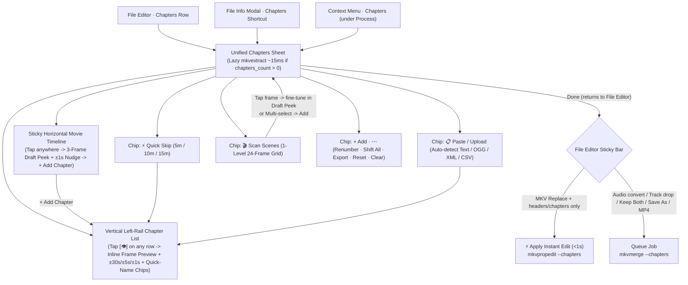

# MKV Forge — Human-First Chapters Editor & Interactive Timeline Spec

**Status:** Finalized Spec (Ready for Phase C1)  
**Target Release:** Post-v1.0.8  
**Design Principles:** One unified screen for desktop & mobile, zero Matroska jargon, zero server disk cache, instant `<1s` in-place saves via `mkvpropedit`, zero idle NAS/HDD impact.

---

## 1. Product Philosophy & Goals

Traditional chapter editors (e.g., MKVToolNix GUI) expose raw Matroska internals (`EditionEntry`, `UID`, `Segment UID`, `00:00:00.000000000` nanosecond fields) and force users to know timestamps by heart. MKV Forge takes a lean, consumer-first approach:

1. **One unified Chapter Editor screen (0 chapters or 50 chapters):** Never force users through a 4-screen modal maze or a separate empty-state page. Both empty files and files with existing chapters open the **exact same screen** — sticky horizontal movie timeline + quick action chips on top, vertical left-rail chapter list below.
2. **Never auto-insert junk chapters on tap:** Tapping the movie timeline shows a clearly labeled **Draft Peek Card** (`Preview · Not added yet`) with 3 fast frames (`-15s | tapped | +15s`) and `±` fine-tuning; the chapter only enters the timeline when the user explicitly taps **`+ Add Chapter`**.
3. **Zero wasted `ffmpeg` work on open:** Existing chapters load in ~15 ms via `mkvextract` with **0 thumbnails fetched** until the user taps `[👁]` on a row (expanding the frame preview + `±` nudges **inline right under that chapter**), taps the timeline bar, or taps **`🎬 Scan Scenes`**.
4. **One mental model for saving:** Chapter edits flow through the File Editor’s existing pending-changes sticky bar — automatically running **⚡ Instant Edit (`<1s · no rewrite`)** via `mkvpropedit` when eligible, or seamlessly bundling into **Stage 2 `mkvmerge`** when combined with audio conversion, track edits, or Keep Both / Save As.
5. **Zero server disk cache & zero new global Settings:** Frames stream directly from `ffmpeg` stdout (`pipe:1`) with browser HTTP caching (`Cache-Control: private, max-age=86400` + video-fingerprint `?v=`). Chapter language silently inherits `Settings → Preferred Track Language`, and save behavior inherits `Default Output Mode`.

### Explicit Non-Goals (MVP)
- Multi-edition Matroska trees, nested sub-chapters, Segment/Ordered chapter linking, and per-chapter multi-language name tables (untouched existing chapters are preserved byte-for-byte verbatim so complex chapters are never accidentally damaged).
- Automatic background Trickplay generation, server-side frame disk caching, or full-stream black-frame/silence detection.
- Separate global Settings toggles for chapters or a top-level sidebar tab.

---

## 2. End-to-End User Flow



---

## 3. UI Design Specification

All components inherit MKV Forge’s semantic design tokens from `frontend/input.css` (`bg-canvas`, `bg-surface`, `bg-elevated`, `bg-inset`, `border-subtle`, `text-ink-primary`, `text-accent`, `--radius-md`, minimum `44px` touch targets via `--control-h-touch`).

### 3.1 Entry Points (Canonical Home + 2 Direct Shortcuts)

All 3 entry points open the **exact same** Chapters Sheet inside the File Editor so every edit shares Output Mode, active-job lock, and **`⚡ Apply Instant Edit (<1s)` vs `Queue Job`**:

1. **Canonical Home — File Editor Container Card:** Always show the `Chapters` row in Section 1 (*Container Metadata*) of `app/static/index.html` (even when `chapters_count == 0`):
   ```text
   ┌─────────────────────────────────────────────────────────────────────────┐
   │ Container Metadata                                                      │
   ├─────────────────────────────────────────────────────────────────────────┤
   │ Title          [ Movie Title (optional)                         ] [×]   │
   ├─────────────────────────────────────────────────────────────────────────┤
   │ [✓] Global Tags    3 entries                                            │
   ├─────────────────────────────────────────────────────────────────────────┤
   │ Chapters           12 chapters                           [ Edit… ]      │
   │  (if 0 chapters)   No chapters                     [ + Add Chapters ]   │
   │  (if edited)       14 chapters  [Modified]               [ Edit… ]      │
   │  (if cleared)      Removed (was 12) [Will Clear]   [ Undo ] [ Edit… ]   │
   └─────────────────────────────────────────────────────────────────────────┘
   ```
2. **Mobile/Couch 1-Tap Shortcut — File Info Modal:** Secondary **`Chapters`** button right next to **`Open in Editor →`** in the Info Modal footer (plus tappable `N Chapters` summary pill when file is ready & idle) → `openEditor(target, { openChapters: true })`.
3. **Desktop Power Shortcut — Right-Click / 3-Dot Context Menu:** Add **`Chapters`** right under **`Process`** in Group 1 (`Process` → `Chapters` → `Info` → `Download`), disabled when busy/scanning/scan-error → `runContextMenuAction('chapters')`.

- **Single source of truth with `Strip Chapters`:** Clearing chapters syncs directly with Advanced Settings `Strip Chapters` (no contradictory states).

---

### 3.2 Primary Surface — Unified Chapters Sheet (Desktop & Mobile)

One cohesive sheet (`max-w-3xl` desktop, `max-h-[90dvh]` full-height bottom sheet on mobile) that handles **both** `chapters_count == 0` and existing chapters without screen switching:

```text
┌─────────────────────────────────────────────────────────────────────────┐
│ Chapters · Movie Name (2h 18m)   [Modified]                     [⋯] [×] │
├─────────────────────────────────────────────────────────────────────────┤
│  Sticky Horizontal Movie Scrubber (40px tap target, chapter dots):      │
│  00:00 ────●────────●───────────────────●─────────────────────── 02:18  │
│                                                                         │
│  [ ⚡ Quick Skip ▾ ]  [ 📋 Paste / Upload ]  [ 🎬 Scan Scenes ]  [+ Add] │
├─────────────────────────────────────────────────────────────────────────┤
│  (Optional inline Undo banner after bulk/destructive action: [ Undo ])  │
│                                                                         │
│  ┌─ Draft Peek Card (shown ONLY when user taps the timeline bar) ────┐  │
│  │ Preview · 01:08:00  (Not added yet)                           [×] │  │
│  │  ┌───────────┐  ┌───────────────┐  ┌───────────┐                  │  │
│  │  │  01:07:45 │  │ ★ 01:08:00 ★  │  │  01:08:15 │  (3 fast frames) │  │
│  │  └───────────┘  └───────────────┘  └───────────┘                  │  │
│  │  [-30s] [-5s] [-1s]   |   [+1s] [+5s] [+30s]  (accurate seek)     │  │
│  │  [ Title (optional)                         ]   [ + Add Chapter ] │  │
│  │  [ Intro ] [ Opening ] [ Intermission ] [ Song ] [ Credits ]      │  │
│  └───────────────────────────────────────────────────────────────────┘  │
│                                                                         │
│  Vertical Left Timeline Rail (Desktop & Mobile):                        │
│  12 chapters                                      [ 🖼 Show Previews ]  │
│  (while streaming: Loading 5/12… [Stop] · once loaded: [ Hide Previews])│
│                                                                         │
│   ●  [ 00:00:00 ]  [ Opening Credits                   ]   [👁]   [🗑]  │
│   │                                                                     │
│   ●  [ 00:14:32 ]  [ The Arrival                       ]   [👁]   [🗑]  │
│   │  ┌─ Inline Chapter Preview (expands right here on [👁] tap) ─────┐  │
│   │  │      [ 16:9 Accurate Frame Preview · 00:14:32 · 480px ]       │  │
│   │  │      [-30s] [-5s] [-1s]     |     [+1s] [+5s] [+30s]          │  │
│   │  │      [ Intro ] [ Opening ] [ Intermission ] [ Song ] [Credits]│  │
│   │  └───────────────────────────────────────────────────────────────┘  │
│   │                                                                     │
│   ●  [ 00:42:17 ]  [ Intermission                      ]   [👁]   [🗑]  │
│   │                                                                     │
│   ○  02:18:00  End of movie                                             │
├─────────────────────────────────────────────────────────────────────────┤
│  3 chapters · Auto-sorted by time               [ Cancel ]    [ Done ]  │
└─────────────────────────────────────────────────────────────────────────┘
```

**Case A (`chapters_count == 0`):**
The exact same header, interactive movie scrubber, and action chips appear — the rail area simply displays:
```text
   ○  00:00:00  No chapters yet — tap the timeline above or pick an option to start.
   │
   ○  02:18:00  End of movie
```

**Mobile Row Adaptation (`< 640px`):**
Same left vertical rail (`●` + vertical connector), with timestamp & actions on line 1 and full-width title input on line 2 (`min-h-[44px]` touch targets):
```text
   ●  [ 00:14:32 ]                       [ 👁 ]  [ 🗑 ]
   │  [ The Arrival                                   ]
```

**Key UX Rules:**
- **Zero scroll-vs-scrub conflict:** Horizontal scrubber stays pinned above the scrollable vertical rail (`overflow-y-auto`), so thumb-scrolling chapters never triggers accidental seeks.
- **Draft Peek Card (3 fast frames in `<0.8s`):** Tapping anywhere on the horizontal bar fetches `-15s`, `tapped`, `+15s` serially via `mode="fast"`. Tapping either side frame centers it; tapping any `±` nudge button switches the center frame to `mode="accurate"` (frame-exact!). Tapping **`+ Add Chapter`** snaps it into the vertical rail below (reusing its loaded frame).
- **Inline Accordion Preview (`[👁]`):** Only 1 chapter row expands at a time; opening another row aborts any in-flight fetch and cleanly switches. Zero frames are extracted on initial modal open.
- **Complex-chapter safety banner:** If `GET /api/files/{id}/chapters` reports `has_complex_chapters: true` (multiple Matroska editions, nested sub-chapters, or ordered chapters), display a 1-line amber notice inside the Chapters Sheet (*"This file uses advanced chapters (multiple editions/nested/ordered). Saving edits will flatten them to a standard list; Cancel keeps them untouched."*).
- **Opt-In `[ 🖼 Show Previews ]` for Existing Chapters (shown only when `chapters.length > 0`):** Keeps modal open instant (~15 ms, zero `ffmpeg` work by default), while giving users 1-tap visual thumbnails beside every existing chapter (ideal for renaming generic Blu-ray `Chapter 01..16` titles). Streams `320px` `mode="fast"` frames serially 1 at a time via the shared `AbortController` (`Loading 5/16… [Stop]`, browser-cached 24h); tapping any loaded thumbnail still expands the `480px` accurate `±1s` fine-tuner inline.
- **1-Tap Quick-Name Chips:** `Intro` · `Opening` · `Intermission` · `Song` · `Credits` appear directly under the title input in both the Draft Peek Card and inline row preview; leaving title empty auto-fills `Chapter NN`.
- **Auto `00:00:00` Start Chapter (TV-player guard):** When adding the first non-zero chapter to an empty list, automatically prepend a removable `00:00:00` (`Chapter 01`) marker so TV players (Jellyfin/Plex/Apple TV) never glitch on Previous Chapter.
- **Quick Skip Inline Popover (`[ ⚡ Quick Skip ▾ ]`):** 1-tap `Every 5m` · `Every 10m (N)` · `Every 15m` pills right under the chip.
- **Fearless 1-Tap Undo:** Bulk/destructive actions (**Clear All**, **Replace from Paste**, **Quick Skip**, **Shift All**, **Renumber**) store a snapshot and display an inline **`Undo`** banner.
- **`⋯` Overflow Menu (Power Tools):**
  - `Renumber Generic Chapters` *(chronologically renumbers `Chapter NN` while preserving custom names like `Intermission`)*
  - `Shift All Timestamps (±)…` *(inline stepper/input in seconds, clamped to `[0, duration_us]`)*
  - `Export Chapters (.txt)` / `Export Chapters (.xml)` *(client-side Blob download)*
  - Divider
  - `Reset to Original` *(visible only when modified)*
  - `Clear All Chapters` *(destructive red tint)*

---

### 3.3 Secondary Views (Optional Drawers Inside the Same Sheet)

1. **1-Level `🎬 Scan Scenes` Grid (For Finding Unknown Songs/Scenes):**
   - Triggered only when the user explicitly clicks `[ 🎬 Scan Scenes ]` (no Level 2 zoom screen!).
   - Clean, mobile-friendly header with **one single 3-preset density row** (persisted in `localStorage` — adapts cleanly across both 20m sitcoms and 3.5h movies without extra minute-pill clutter):
     - `← Back` · `Scan Scenes (2h 18m)` · `Loading 14/24… [Stop]`
     - `[ Compact · 12 ]` · `[ Balanced · 24 ★ ]` · `[ Detailed · 40 ]`
   - Responsive `grid-cols-2 sm:grid-cols-3 md:grid-cols-4 gap-2.5` of `320px` fast-seek JPEGs streamed **1 at a time** via `AbortController`.
   - **Tap a tile:** Aborts remaining fetches (preserving already-loaded tiles in browser RAM for `0 ms` return!), returns to the Main Sheet, and opens the **Draft Peek Card** at that tile's timestamp so you can `±1s` fine-tune and add!
   - **Tap corner checkbox (`44×44px` hit zone):** Multi-select multiple scenes and tap **`+ Add N Chapters`** in one click.

2. **Unified `📋 Paste / Upload` Drawer:**
   - Single textarea + drag-and-drop / `[ Choose File (.txt, .xml)… ]` button.
   - Auto-detects Matroska XML, OGG (`CHAPTER01=`), YouTube/plain text (`00:00 Intro`), or CSV via `POST /api/files/{id}/chapters/parse`.
   - Shows live `Detected: N chapters (format)` + `Replace existing` / `Merge with existing` toggle when chapters already exist.

---

## 4. Technical Architecture & Guardrails

### 4.1 Guardrail #1 — Fixing the `±1s` Keyframe Trap (Dual-Mode Seeking)

Pure input-seeking (`-ss <ts>` before `-i`) jumps to the nearest IDR keyframe (often 4–10s away), so `±1s` nudges would return the same frozen image. We use **two explicit seek modes**:

| Mode | Used By | FFmpeg Command Shape | Latency | Accuracy |
|---|---|---|---|---|
| **`fast`** | Timeline 3-frame Draft Peek & `🎬 Scan Scenes` Grid | `ffmpeg -v error -ss <ts> -i <file> -an -sn -dn -frames:v 1 -vf "scale='min(320,iw)':-2,format=yuvj420p" -q:v 5 -f image2pipe -vcodec mjpeg pipe:1` | ~100–250 ms | Nearest keyframe (ideal for browsing) |
| **`accurate`** | Inline Row Preview `[👁]` & `±30s / ±5s / ±1s` Nudges | `pre_seek = max(0.0, ts - 10.0)`<br>`post_seek = ts - pre_seek`<br>`ffmpeg -v error -ss <pre_seek> -i <file> -ss <post_seek> -an -sn -dn -frames:v 1 -vf "scale='min(480,iw)':-2,format=yuvj420p" -q:v 4 -f image2pipe -vcodec mjpeg pipe:1` | ~250–600 ms | **Frame-exact** (decodes ≤10s GOP delta from keyframe) |

**10-bit HDR / HEVC / Dolby Vision & EOF Safety:**
- Lightweight `scale='min(W,iw)':-2,format=yuvj420p` — **zero** heavy CPU `zscale` / `tonemap` filters (proven safe on FFmpeg 7+ MJPEG in `thumbnail_service.py`).
- **EOF timestamp clamp:** Both backend (`clamp_frame_timestamp_ms`) and frontend scrubber/nudge clamp requested timestamps to `[0, max(0, duration_sec - 0.5)]` (`SCENE_FRAME_EOF_MARGIN_MS = 500`) so tapping the far end of the scrubber or nudging past EOF never yields an empty 0-byte `ffmpeg` stream.
- Streams the single ~15–30 KB JPEG directly via `pipe:1` in memory — **zero temp files written to SSD**.

---

### 4.2 Guardrail #2 — Real Instant Cancellation (Client + Backend Subprocess Kill)

1. **Client-Side Serial Fetching (Zero Parallel `` Storms):**
   - **Never** render 24 parallel `` tags.
   - Maintain a single active `AbortController` (`_sceneFetchAbortController`) and fetch frames **serially (1 request at a time)** via `fetch(url, { signal })` → `URL.createObjectURL(blob)`.
   - **Memory-leak prevention:** Keep loaded `Scan Scenes` `objectUrl`s in browser RAM while the Chapters modal stays open (so returning to the grid is `0 ms`), and revoke **all** `objectUrl`s via `URL.revokeObjectURL(url)` on modal close, step-density change, or frame replacement.
   - Closing the modal, clicking **Stop**, switching rows, tapping a new timeline spot, or nudging `±1s` immediately aborts the active `AbortController` (with `180ms` debounce + optimistic timestamp update on rapid `±` taps).

2. **Backend Disconnect-Aware `ffmpeg` Termination:**
   - `GET /api/files/{file_id}/frame` runs `ffmpeg` bounded by `asyncio.Semaphore(AppConstants.SCENE_FRAME_MAX_CONCURRENCY)` (`1`), with best-effort low I/O priority (`ionice`/`nice`) when an unrelated job is active.
   - Races `proc.communicate()` against `request.is_disconnected()` polling (`0.15s`) and `SCENE_FRAME_TIMEOUT_SEC` (`10.0s`).
   - On disconnect or timeout: immediately `proc.terminate()` → grace `0.5s` → `proc.kill()` + `await proc.wait()`.

---

### 4.3 Guardrail #3 — Active-Job Conflict Protection & Zero Server Disk Cache (Option A)

1. **Active-Job Safety (`409 Conflict`):**
   - Before reading chapters (`GET /chapters`) or extracting a frame (`GET /frame`), check `job_repo.get_active()`.
   - If the active job targets the **same file** in **`replace`** mode (or `save_as` with `delete_original=True` on the same source), return **`HTTP 409 Conflict`** immediately.
   - Unrelated active jobs remain allowed (serialized to 1 frame at a time with best-effort low I/O priority).
   - Non-ready files (`scan_status != "ready"`) return `409 Conflict`; non-video / 0-duration files return `400 Bad Request`.

2. **Zero Server Disk Cache (Browser RAM + HTTP Cache Only):**
   - **Zero SSD writes on the server:** `ffmpeg` writes straight to `pipe:1` → HTTP response; zero `/app/data` cache directories or eviction logic.
   - **Instant repeat edits via Browser HTTP Cache:** Client appends `?v=<duration_us>_<resolution>_<video_codec>` and server responds with `Cache-Control: private, max-age=86400`. Editing chapters/titles/flags or audio does not change the video fingerprint, so reopening the same movie serves frames from the browser cache instantly; upgrading/replacing the video cut busts `v=` automatically.

---

## 5. Backend Module Segregation & API Contract

| File | Responsibility |
|---|---|
| `app/config.py` | Centralized chapter & scene-frame constants (zero magic numbers). |
| `app/models/schemas.py` | `ChapterEntry`, `ChaptersReadResponse`, `ChaptersParseRequest`, `ChaptersParseResponse`; extend `ContainerMetadataConfig` with `chapters_action: Literal["keep", "replace", "clear"] = "keep"` and `chapters: list[ChapterEntry] | None = None` (backward-compatible with legacy `strip_chapters=True`). |
| `app/services/chapter_service.py` *(new)* | `extract_chapters_from_file` (`mkvextract` for `.mkv`, `ffprobe -show_chapters -print_format json` fallback for `.mp4`), safe Matroska XML parser (returning `has_complex_chapters` for multi-edition/nested/ordered chapters) & serializer, unified auto-detecting `parse_chapters_text` (XML, OGG, YouTube/plain text, CSV), timestamp helpers. |
| `app/services/scene_frame_service.py` *(new)* | Stateless `extract_scene_frame`, EOF timestamp clamping (`[0, max(0, duration - 0.5s)]`), dual-mode `fast`/`accurate` FFmpeg `image2pipe` (`pipe:1`) argv builder, disconnect-aware terminate/kill runner, JPEG magic-byte validation. |
| `app/api/chapters.py` *(new)* | FastAPI router mounted in `app/main.py`: `GET /api/files/{file_id}/chapters` (returns `{ file_id, duration_us, chapters, has_complex_chapters }`), `POST /api/files/{file_id}/chapters/parse`, `GET /api/files/{file_id}/frame`. |
| `app/services/mkvpropedit_runner.py` | Allow `chapters_action in ("keep", "replace", "clear")` for `<1s` instant edit; emit `--chapters <tmp.xml>` or `--chapters ""`. |
| `app/services/mkv_builder.py` | Emit `--no-chapters --chapters <tmp.xml>` (`replace`), `--no-chapters` (`clear`), or nothing (`keep`). |
| `app/services/mkv_runner.py` | Materialize temp chapters XML before `mkvpropedit` / `mkvmerge` and guarantee deletion in `finally:`. |
| `app/services/job_summary.py` | Concise chapter summary pills (`Updated N Chapters` / `Cleared Chapters`). |
| `app/static/js/constants.js` | `CHAPTERS` & `SCENE_PICKER` constants (`NUDGE_STEPS_SEC`, `PEEK_OFFSET_SEC: 15`, `EOF_MARGIN_MS: 500`, `QUICK_INTERVALS_MIN`, `QUICK_NAME_CHIPS`, `SCAN_DENSITY_PRESETS: [12, 24, 40]`, `SCAN_DENSITY_STORAGE_KEY`, `FINE_TUNE_DEBOUNCE_MS`). |
| `app/static/js/chapters.js` *(new)* | Pure chapter & timeline helpers: forgiving time parser/formatter, Quick Skip generator, auto-`00:00:00` guard, generic-only chronological renumbering, Shift All, 3-frame peek timestamps (`-15s / 0 / +15s`), Scan Scenes slots, video fingerprint, OGG/XML exporters, dirty-state diff. |
| `app/static/js/editor.js` | Integrate `chaptersAction` + `chapters` into `createEditorState`, `hasPendingChanges`, `isInstantHeaderEditEligible`, `buildPendingSummary`, `buildJobRequestPayload`. |
| `app/static/js/app.js` & `app/static/index.html` | 3 entry points + Unified Chapters Sheet (sticky horizontal scrubber, Draft Peek Card, vertical left-rail list with inline expandable preview, optional 1-level Scan Scenes grid, unified Paste/Upload drawer, `⋯` menu). |

### Save Pipeline Matrix (`mkvpropedit` vs `mkvmerge`)

| Scenario | `chapters_action` | Tool Used | Command Addition | Speed |
|---|---|---|---|---|
| Untouched chapters | `"keep"` | Unchanged | *(none — existing chapters preserved verbatim)* | Unchanged |
| MKV `replace` + only headers/chapters edited | `"replace"` | **`mkvpropedit`** | `--chapters <tmp.xml>` | **`< 1s` in-place** |
| MKV `replace` + cleared all chapters (only) | `"clear"` | **`mkvpropedit`** | `--chapters ""` | **`< 1s` in-place** |
| MKV `replace` + audio convert / track drop / tag strip | `"replace"` / `"clear"` | **`mkvmerge`** | `--no-chapters --chapters <tmp.xml>` / `--no-chapters` | Full remux |
| Keep Both / Save As / `.mp4` → `.mkv` | `"replace"` / `"clear"` | **`mkvmerge`** | `--no-chapters --chapters <tmp.xml>` / `--no-chapters` | Full remux |

---

## 6. Verification & Testing Plan

1. **`tests/unit/test_chapter_service.py`:** XML round-trip (Unicode, `& < > "`), OGG / YouTube / CSV auto-detection, duration clamping & duplicate handling, XXE/DTD rejection, `strip_chapters=True` backward compatibility, and `mkvextract` failure/timeout handling.
2. **`tests/unit/test_scene_frame_service.py` & `tests/integration/test_chapters_api.py`:** Exact `fast` vs `accurate` (`pipe:1`, `format=yuvj420p`) argv, disconnect kill, real 10-bit `yuv420p10le` MKV distinct frames 1s apart, `409 Conflict` on active `replace` job, `200 OK` on unrelated active job, `Cache-Control: private, max-age=86400`, zero files written to `<data_dir>`.
3. **`tests/unit/test_chapters_pipeline.py`:** `can_use_instant_header_edit` parity, exact `mkvpropedit` / `mkvmerge` argv, real `mkvpropedit` + `mkvextract` round-trip (`replace` & `clear`), and guaranteed temp XML cleanup.
4. **`tests/unit/test_chapters_frontend.py` & `tests/unit/test_index_html_structure.py`:** Node VM tests for `chapters.js` & `editor.js`, balanced HTML tags, all 3 entry points (`Process` → `Chapters` → `Info` → `Download`, Info Modal `Chapters`, Editor row), unified sheet landmarks, and `AbortController` / `URL.revokeObjectURL` verification.
